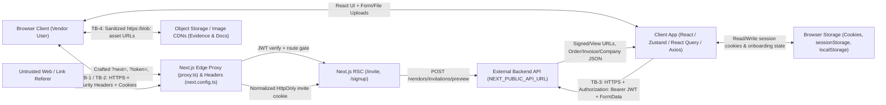

# Villeto Vendor Portal — Threat Model & Security Architecture

> **Methodology:** STRIDE + Data Flow Diagramming (DFD) + OWASP Top 10:2025 / ASVS 5.0.0 / API Top 10 / MITRE CWE Top 25  
> **Scope:** `villeto-vendor` (Next.js 16 App Router Frontend + Edge `proxy.ts` + External Backend API Integration)  
> **Tooling Note:** Microsoft Threat Modeling Tool desktop application was not available in this CLI environment; equivalent DFDs, trust boundaries, assets, and a structured STRIDE threat register are maintained here in the repository.

---

## 1. System Architecture & Trust Boundaries

`villeto-vendor` is a Next.js App Router frontend and Edge Proxy (`proxy.ts`) communicating over HTTPS with an external backend API (`NEXT_PUBLIC_API_URL`, defaulting to `https://api.villeto.com`). This repository contains **no custom Next.js API routes, no Server Actions, and no direct database driver**. Persistence, multi-tenant company authorization, financial state transitions, document object storage, and email delivery reside in the external backend service.

### Trust Boundaries

1. **TB-1: Untrusted Public Internet <-> Browser Client**
   - Phishing links, attacker-supplied query strings (`?next=...`, `?token=...`, `/invite?<raw>`), third-party script/framing attempts, and XSS payloads.
2. **TB-2: Browser Client <-> Next.js Edge Proxy & Web Tier (`proxy.ts`, `next.config.ts`)**
   - Request routing, cookie transport (`villeto_auth_token`, `villeto_invite_token`, status cookies), JWT verification at the Edge, and browser security headers (CSP, HSTS, `X-Frame-Options`, `X-Content-Type-Options`, `Referrer-Policy`).
3. **TB-3: Browser / Next.js Server Component <-> External Backend API (`apiClient`, `uploadClient`, `/invite`, `/signup`)**
   - Bearer JWT authentication (`Authorization: Bearer <token>`), multi-company tenant switching (`switch-company`), multipart document/evidence uploads, and invitation token validation.
4. **TB-4: External Backend API <-> Document/Evidence Object Storage & CDN**
   - Presigned or API-proxied file viewing URLs (`fileUrl`, `viewEndpoint`) and remote flags/avatars (`flagcdn.com`, OAuth image hosts).
5. **TB-5: Build / Supply Chain <-> Runtime Host**
   - npm dependencies (`next`, `axios`, `zod`, transitive packages), ESLint/TypeScript tooling, and environment variables (`JWT_SECRET`, `NEXT_PUBLIC_API_URL`).

---

## 2. Data Flow Diagram (DFD)

---

## 3. Sensitive Assets & Data Flows

| Asset ID | Asset | Sensitivity | Origin | Transit / Storage | Destination |
|---|---|---|---|---|---|
| A-1 | Vendor Auth JWT (`villeto_auth_token`) | Critical | Backend `/vendors/auth/login` & `/switch-company` | Non-`HttpOnly` cookie (`SameSite=Lax`), attached as `Authorization: Bearer` header in `lib/api/client.ts` | Backend API endpoints & Next.js Edge `proxy.ts` |
| A-2 | Invitation Token (`villeto_invite_token`) | High | Email invite URL `/invite?<uuid>.<sig>` or `/invite?token=...` | Set as `HttpOnly`, `SameSite=Lax`, `Secure` (prod) cookie in `proxy.ts`; read server-side by `/invite` and `/signup` | `POST /vendors/invitations/preview` & `/vendors/invitations/accept` |
| A-3 | Banking & Payout Details | Critical | Onboarding & Settings bank forms | React form -> HTTPS JSON PATCH; masked (`••••1234`) in company read responses | Backend payout ledger |
| A-4 | KYC / Compliance Documents | High | Vendor file dropzones & settings modal | Local `blob:` preview (revoked after use) -> HTTPS multipart FormData | Backend object storage |
| A-5 | Orders, Invoices & Dispute Evidence | High | Backend API JSON & uploaded dispute photos | TanStack Query in-memory cache; evidence URLs sanitized in `EvidenceGallery.tsx` | Vendor dashboard UI & Backend API |
| A-6 | Status & Routing Cookies (`villeto_vendor_status`, `villeto_approval_status`, `villeto_active_company_id`, `villeto_decision_note`) | Medium | Auth responses in `authStore.ts` & `Providers.tsx` | Cookies (`SameSite=Lax`, `Secure` in prod) + `sessionStorage` Zustand stores | Client UI guards & Edge routing |

---

## 4. STRIDE Threat Register

| Threat ID | Component / Asset | STRIDE | Attacker Capability & Prereqs | Attack Scenario / Exploitation Path | Impact | Existing Controls (Pre-Audit) | Weakness / Missing Control | Risk | Mitigation | Status | Verification & Residual Risk |
|---|---|---|---|---|---|---|---|---|---|---|---|
| TM-01 | `app/(auth)/auth/login/page.tsx`, `proxy.ts`, `Providers.tsx` (`next` query parameter) | **S**poofing / **I**nformation Disclosure | Unauthenticated attacker crafts phishing link `/auth/login?next=//evil.com` or `https://evil.com` | Victim signs in with valid credentials; app executes `router.replace(next)` / `window.location.href = next` and redirects victim to attacker-controlled phishing clone | Credential phishing / post-login session hijack | None beyond client routing | Raw `searchParams.get("next")` passed directly to navigation sinks | **High** | Added `sanitizeRedirectPath()` (`lib/security/redirect.ts`) enforcing single-slash internal paths and rejecting `//`, `/\`, encoded slashes, schemes, control chars, and auth self-loops | **Implemented** | Unit tests in `tests/security/security-controls.test.ts` pass; residual risk: Low |
| TM-02 | `proxy.ts` (`PROTECTED_ROUTES`, JWT check) | **E**levation of Privilege / **S**poofing | Unauthenticated user or holder of forged/expired JWT | Requests `/settings`, `/companies`, or `/notifications` unauthenticated, or supplies arbitrary non-empty `villeto_auth_token` string (e.g. `foo`) or expired JWT to pass Edge middleware | Exposure of protected UI shells/routes; bypass of `/auth/login` redirect gate | Presence check on `/dashboard`, `/orders`, `/invoices`, `/profile`, `/pending`; backend 401 on API data | `/companies`, `/settings`, `/notifications` missing from `PROTECTED_ROUTES`; Edge proxy never checked JWT signature or `exp` | **High** | Added `/companies`, `/settings`, `/notifications` to `PROTECTED_ROUTES`; added Web Crypto `verifyJwtToken()` validating structure, rejecting `alg: none` & expired `exp`, and verifying HMAC signature when `JWT_SECRET` is configured; stale invalid cookies cleared | **Implemented** | Proxy integration tests in `tests/security/proxy.test.ts` pass; residual risk: Medium until backend/infra configures `JWT_SECRET` or JWKS in frontend Edge env |
| TM-03 | `app/(onboarding)/invite/page.tsx`, `signup/page.tsx`, `proxy.ts` | **I**nformation Disclosure / **S**poofing | Local user, browser history viewer, telemetry script, or external link `Referer` target | Clicking "Start Vendor Setup" navigated to `/signup?token=...&email=...&legalName=...`, exposing invite bearer token and PII in URL history and logs; `villeto_invite_token` lacked `secure` flag | Invite bearer token & vendor PII leakage | `httpOnly` cookie partially set only on raw-token redirect | Token + PII placed in `/signup` query URL; `villeto_invite_token` missing `secure` flag | **High** | `/signup` converted to Server Component reading `villeto_invite_token` `HttpOnly` cookie and passing verified context via RSC props; `invite/page.tsx` CTA links to clean `/signup`; legacy URL query scrubbed with `history.replaceState`; `secure` flag enabled in prod | **Implemented** | Verified in `proxy.test.ts` & code inspection; residual risk: Low (initial email invite arrives on `/invite?<token>`, scrubbed on subsequent navigation; backend should use short-lived single-use invites) |
| TM-04 | `app/(onboarding)/onboarding/documents/page.tsx`, `[companyId]/documents/page.tsx`, `settings/page.tsx`, `DisputeBuyerResponseModal.tsx`, `ResolutionModal.tsx` | **T**ampering / **E**levation / **I**nformation Disclosure | Authenticated vendor uploads malicious file (SVG/HTML/executable renamed `.png`/`.pdf`) | Weak `MIME || ext` check (or missing check in Settings & Dispute modal) accepts active `<svg>`/`<html>` disguised as PNG/PDF, risking stored XSS if backend serves inline | Stored XSS via uploaded active content, oversized uploads, `blob:` memory leaks | Partial size/MIME checks in 2 components | Missing type validation in Settings & Dispute modal; OR instead of AND check; zero magic-byte inspection; `.doc`/`.docx` passed to `<iframe>`; unrevoked `URL.createObjectURL` | **High** | Implemented centralized `validateUploadFile()` (`lib/security/upload.ts`) enforcing size limits, non-empty check, strict extension + MIME validation, active `<svg>`/`<html>`/`<script>` rejection, and binary magic-byte header verification; revoked `blob:` URLs cleanly | **Implemented** | Tested against spoofed `<svg>`-as-`.png` and mismatched magic bytes in `security-controls.test.ts`; residual risk: Low client-side (backend AV/MIME/attachment headers remain required) |
| TM-05 | `EvidenceGallery.tsx`, `settings/page.tsx`, `[companyId]/documents/page.tsx`, `[companyId]/page.tsx` | **S**poofing / **T**ampering (Stored XSS via URI scheme) | Compromised API payload or malicious buyer/vendor metadata returning `javascript:` or `data:text/html` URL | Rendered directly into `<a href>` / `` (`EvidenceGallery`, Settings document View button) | Script execution on click (`javascript:`) or unexpected external/mixed-content load | `rel="noopener noreferrer"` on `<a>` | No protocol validation on `url` / `fileUrl`; hardcoded `https://api.villeto.com` instead of `NEXT_PUBLIC_API_URL` | **Medium-High** | Added `sanitizeSafeUrl()` & `resolveSafeApiAssetUrl()` (`lib/security/urls.ts`) permitting only `https:`/`http:` (and `blob:` only for local previews) across `EvidenceGallery`, `settings/page.tsx`, and V2 document pages | **Implemented** | Verified in `security-controls.test.ts`; residual risk: Low |
| TM-06 | `lib/api/*.ts` (`orders.ts`, `invoices.ts`, `vendor-network.ts`, `messaging.ts`, `notifications.ts`, `onboarding.ts`) | **T**ampering (URL Path / Query Injection) | Untrusted route param / ID / country string containing `/`, `..`, `?`, `#`, `&` | Unencoded interpolation into `${purchaseOrderId}`, `${invoiceId}`, `${companyId}`, `${country}` could alter backend REST routing path or query parameters | Client-side request path confusion / unintended endpoint hit | Axios baseURL + JWT scope | Dynamic path & query parameters interpolated raw without `encodeURIComponent` | **Medium** | Applied `encodeURIComponent` across all API endpoint interpolations and added `encodePathSegment` utility | **Implemented** | Verified in `security-controls.test.ts` and `tsc`; residual risk: Low |
| TM-07 | `next.config.ts` (Web-Tier Security Headers & CSP) | **T**ampering / **I**nformation Disclosure | Network MitM, malicious browser extension, third-party script or frame embedding | Missing `Content-Security-Policy`, missing HSTS (`Strict-Transport-Security`), exposed `X-Powered-By: Next.js` | Increased XSS impact surface, downgrade/HTTP exposure, stack fingerprinting | `X-Frame-Options: DENY`, `X-Content-Type-Options: nosniff`, `Referrer-Policy`, `Permissions-Policy` | No CSP, no HSTS, `poweredByHeader` enabled | **Medium-High** | Configured CSP (`object-src 'none'`, `base-uri 'self'`, `form-action 'self'`, `frame-ancestors 'none'`, `frame-src 'self' blob:`, scoped `connect-src`), HSTS in production, `X-DNS-Prefetch-Control: off`, `poweredByHeader: false` | **Implemented** | Verified via `next build`; residual risk: Medium while `'unsafe-inline'` remains required for Next.js static prerendered pages |
| TM-08 | `package.json` / `package-lock.json` (`next@16.2.10`, `axios@1.x`, `zod@4.1.5`) | **E**levation / **D**oS / **T**ampering | Remote attacker targeting Next.js Image Optimization / RSC / Middleware, or crafting Axios/Zod payloads | Known CVEs/GHSAs in `next` (critical RCEs, SSRF, proxy bypass), `axios` (prototype pollution, ReDoS, SSRF), and `zod` (memory exhaustion DoS) | Remote code execution on Next.js server, DoS, request tampering | TypeScript type checking | Outdated vulnerable package versions (17 total audit findings: 1 critical, 9 high, 7 moderate) | **Critical** | Upgraded to `next@16.4.6`, `eslint-config-next@16.4.6`, `axios@^1.20.0`, `zod@^4.6.7`, and ran `npm audit fix`; reduced audit findings from 17 (1 crit / 9 high) to 7 moderate dev-only `minimatch` (`eslint-config-next` transitive) with **0 runtime vulnerabilities** | **Implemented** | Verified via `npm audit` and `npm run build` |
| TM-09 | `lib/api/auth.ts`, `client.ts`, `authStore.ts`, `settings/page.tsx`, `lib/validations/index.ts` | **T**ampering / **I**nformation Disclosure / **D**oS | Shared workstation user or user submitting masked bank number or oversized payloads | Partial logout/401 cleanup left `decisionNote` cookie & `sessionStorage` company/onboarding caches behind; Settings bank form initialized masked `"••••1234"` and submitted it without format guard; unbounded numeric/collection schemas | Cross-session stale state exposure; accidental bank account corruption; validation DoS | Partial cookie removal in `authStore.ts` | Duplicated `clearSessionCookies` diverged across 3 files; no masked-account guard in Settings; missing max bounds in Zod schemas | **Medium** | Centralized `clearAllClientSessionState()`, added masked/10-digit check in `settings/page.tsx` `handleSaveBank()`, added finite/max bounds in `lib/validations/index.ts` | **Implemented** | Verified via `security-controls.test.ts` and `tsc` |
| TM-10 | `lib/constants/auth.ts` + External Auth API (`villeto_auth_token` non-`HttpOnly`, client-readable status cookies) | **I**nformation Disclosure / **E**levation of Privilege | XSS payload or malicious user editing browser cookies (`villeto_vendor_status`, `villeto_approval_status`) | JS reads `villeto_auth_token` via `document.cookie`; modifying `villeto_vendor_status=active` bypasses client/Edge UI gate | Bearer JWT theft if XSS occurs; UI-only route gate bypass (if backend lacks enforcement) | `SameSite=Lax`, `Secure` in prod, CSP, URL/upload sanitization | Frontend requires `js-cookie` to read JWT for cross-origin `Authorization: Bearer` header until backend issues `HttpOnly` session cookies | **High (Architectural)** | Hardened XSS surface and centralized cleanup in frontend; documented exact BFF / `HttpOnly` cookie + CSRF migration and backend RBAC enforcement requirements | **Documented (Backend / Infra Required)** | Requires backend auth cookie architecture change & server-side authorization verification |
